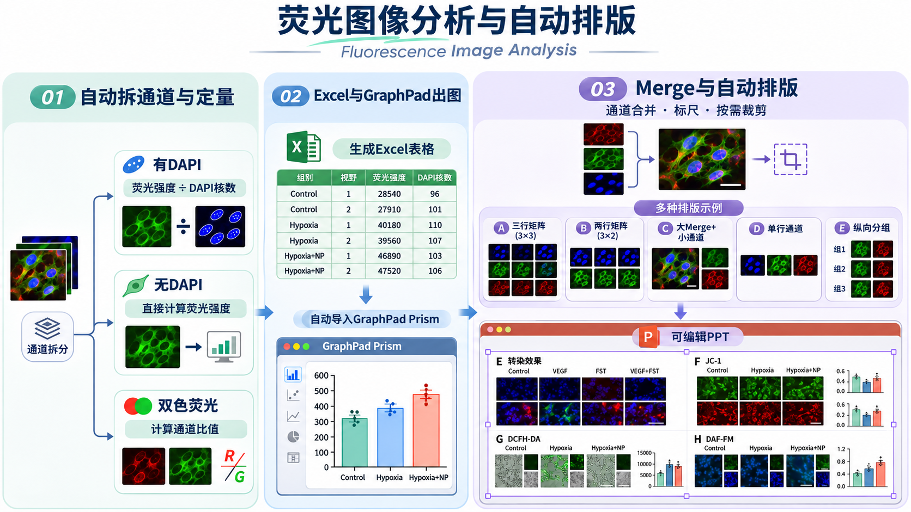

# Fluorescence Image Analysis

用于 Codex 的荧光图像定量、GraphPad Prism 出图与代表图排版 skill。

## 功能

1. **自动拆通道与定量**：有 DAPI 时建议核计数和每核荧光；无核染时建议直接计算荧光强度；双色目标可计算通道比值。实际指标先扫描再给建议。
2. **Excel 与 GraphPad Prism**：整理逐视野、孔级和有依据的样本级结果，生成 Excel、Prism 可编辑工程及原生统计图。
3. **代表图制作**：ImageJ Merge、标尺、按需裁剪、A–E 布局与多实验整区排版；PPT 图片和文字分别可编辑。

## 安装

下载 [完整 skill 安装包](fluorescence-image-analysis.zip)，解压得到 fluorescence-image-analysis 文件夹，放入 Codex 的 skills 目录，确保文件夹根目录包含 SKILL.md。安装包内包含全部脚本、参考文档、模板与资源。

打开新对话，调用 $fluorescence-image-analysis，并给出实验图片目录。

示例：
- “分析这个目录，先扫描并建议定量指标。”
- “这些图已经完成 PS，照参考布局制作代表图，不裁剪。”
- “制作代表图，需要裁剪；先给我看完整图上的选框。”

## 最少询问

- 定量：指标未明确时，扫描后提出建议并集中询问。
- 重复结构：展示每孔 3 视野、每组 3 孔的可修改示例；默认组织仅代表孔级汇总，不能证明生物学独立性。
- 代表图：询问是否裁剪；需要时再确认 ROI。
- 分组名称沿用来源；有布局参考图优先照图，无图给适用建议。
- 使用者需要 PS 时应在运行前自行处理；Merge 技术检查通过后继续，无额外效果确认关卡。

## 运行条件

需要本地 ImageJ/Fiji；Prism 原生出图需要已安装 GraphPad Prism。Excel/PPT 作者模块依照执行环境可用的相应 Codex 技能与运行时执行；本仓库不是脱离 Codex 的一键桌面软件。运行前发现实际软件位置，不套历史机器路径。

## 数据与适用范围

原始图像只读。PS、展示、裁剪和标尺版本不回流定量。核心定量支持 8/16-bit 二维图像；新细胞、新成像条件先做 pilot。代表图保持输入显示效果，不自动修补细胞或改变科研内容。物理标尺需要适用的校准，未知时保留无标尺版本。

仓库路径已替换为占位符，历史脚本仅供适配参考；模板为随 skill 保存的 Prism 示例。首页图中的显微图和图表为生成示意，不是实际实验结果。

详细规则见安装包内的 SKILL.md 和 references/；所有源文件均保留在安装包内。

