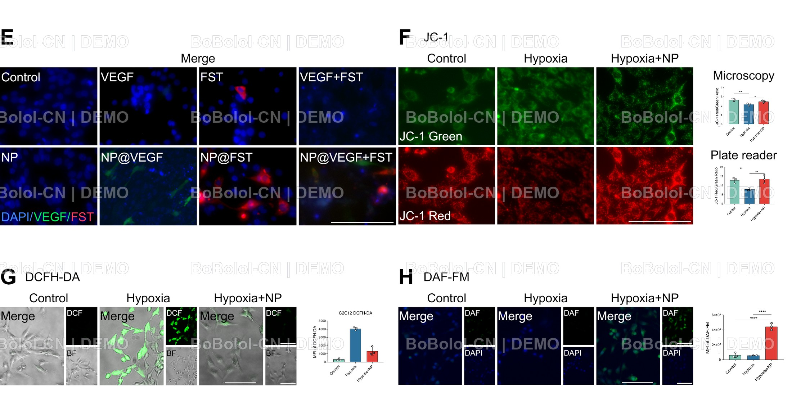
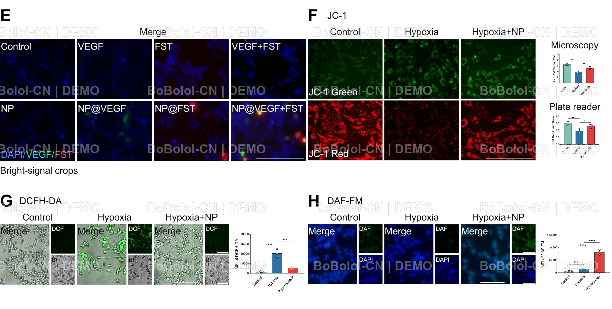

# Fluorescence Image Analysis

荧光图像分析与自动排版：ImageJ/Fiji 定量 → Excel → GraphPad Prism → Merge、标尺与可编辑 PPT。


## 一条命令安装

在 **PowerShell** 中运行：

```powershell
irm https://raw.githubusercontent.com/BoBolol-CN/fluorescence-image-analysis/main/install.ps1 | iex
```

安装器下载完整 skill、校验 SHA-256，并安装到 CODEX_HOME/skills；未设置 CODEX_HOME 时使用 ~/.codex/skills。已有同名目录时会停止，不覆盖你的本地版本。安装完成后打开新的 Codex 对话，使用 $fluorescence-image-analysis。

也可下载 [完整安装包](fluorescence-image-analysis.zip) 手动安装。全部脚本、参考文档、模板和资源都在包内。

## 三类定量

| 输入 | 建议指标 |
|---|---|
| 目标荧光＋DAPI/Hoechst | 核计数、目标积分荧光/核数 |
| 无核染的单目标荧光 | 全视野MFI，按目的选择总荧光 |
| 两个目标荧光通道 | 通道比值，或分别定量 |

AI 先扫描，再建议实际指标；视野、孔和样本分层汇总，输出 Excel、Prism 工程及原生图。代表图可自动选图、拆分/合并通道、添加标尺并排版。需要裁剪时先展示完整图上的选框。PPT 的图片、组名和标签分别可编辑。

## 实际处理示例

以下为作者提供并授权展示的实际实验结果预览，均叠加 BoBolol-CN | DEMO 水印。仅展示图像处理和排版能力，不据此解释生物学结论；未提供原始实验文件、可编辑工程或完整分辨率数据。顶部功能介绍图中的细胞和图表为生成示意。

### 示例一：C2C12 多实验整区排版

转染 8 组、JC-1 红绿双通道、DCFH-DA 与 DAF-FM 组合在同一版面，统计图置于相应模块右侧。下方采用“大 Merge＋两张小通道图”的紧凑组合，标尺为白色纯横线。



### 示例二：EC 多实验整区排版

展示统一列宽、组别标签、小通道标签和标尺位置的排版效果。



### 示例三：先确认选框，再裁剪

完整视野保留在左侧，选框标出裁剪区域，右侧展示对应裁剪效果。同视野的各通道和 Merge 使用相同 ROI，调整位置时保持裁剪尺寸。


## 使用示例

```text
$fluorescence-image-analysis
分析这个文件夹，先扫描并建议定量指标。
```

```text
$fluorescence-image-analysis
这些图已经完成 PS，照我提供的布局制作代表图，不裁剪。
```

```text
$fluorescence-image-analysis
制作代表图，需要裁剪。先给我看完整图上的选框，确认后生成可编辑 PPT。
```

## 运行条件与边界

需要本地 ImageJ/Fiji；Prism 原生出图需要已安装 GraphPad Prism。Excel/PPT 作者模块按当前 Codex 环境可用的相应技能与运行时执行。本仓库是 Codex skill，不是独立桌面软件。

原始图像只读，PS/展示图不回流定量。核心支持 8/16-bit 二维图；新成像条件先做小批试算。实际指标未明确时集中询问；重复结构展示每孔 3 视野、每组 3 孔的可改示例，不能据此宣称生物学独立性。代表图仅补是否裁剪，裁剪时确认 ROI。物理标尺须有适用校准。

包内机器路径已替换为占位符；历史脚本需适配当前环境。更多技术规则见安装包内 SKILL.md 与 references/。
