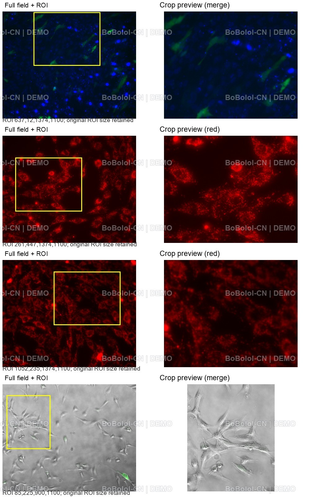

# Fluorescence Image Analysis

荧光图像分析与自动排版：ImageJ/Fiji 定量 → Excel → GraphPad Prism → Merge、标尺与可编辑 PPT。支持 **Claude Code 和 Codex**。


## 安装到 Claude Code 和 Codex

已安装 Node.js 22.20+ 后，在终端运行以下一条命令，同时安装到两个客户端：

```bash
npx skills add https://raw.githubusercontent.com/BoBolol-CN/fluorescence-image-analysis/main/fluorescence-image-analysis.zip -g -a claude-code codex --copy
```

只安装其中一个客户端时：

```bash
# Claude Code
npx skills add https://raw.githubusercontent.com/BoBolol-CN/fluorescence-image-analysis/main/fluorescence-image-analysis.zip -g -a claude-code --copy

# Codex
npx skills add https://raw.githubusercontent.com/BoBolol-CN/fluorescence-image-analysis/main/fluorescence-image-analysis.zip -g -a codex --copy
```

命令可在 PowerShell、macOS 或 Linux 终端执行；PowerShell 只是终端，不是所需客户端。`-g` 表示全局安装，`--copy` 使用文件副本，避免 Windows 符号链接权限问题。安装采用 [Vercel Skills CLI](https://github.com/vercel-labs/skills)。

安装后打开新会话：Claude Code 输入 `/fluorescence-image-analysis`，Codex 输入 `$fluorescence-image-analysis`，再附图片文件夹路径和需求。

也可下载 [完整 skill ZIP](fluorescence-image-analysis.zip)，将其中的 `fluorescence-image-analysis` 文件夹放到 Claude Code 的 `~/.claude/skills/` 或 Codex 的 `$CODEX_HOME/skills/`（未设置时为 `~/.codex/skills/`）。Claude 网页版可通过自定义技能入口导入 ZIP，但网页环境不能因此直接操作你的本地 Fiji、Prism 或磁盘。

全部源码、脚本和参考文档均包含在完整 skill ZIP 中。

## 三类定量

| 输入 | 建议指标 |
|---|---|
| 目标荧光＋DAPI/Hoechst | 核计数、目标积分荧光/核数 |
| 无核染的单目标荧光 | 全视野MFI，按目的选择总荧光 |
| 两个目标荧光通道 | 通道比值，或分别定量 |

AI 先扫描，再建议实际指标；按视野、孔和样本分层汇总，输出 Excel、Prism 工程及原生图。代表图可自动选图、拆分/合并通道、添加标尺并排版。需要裁剪时先展示完整图上的选框。PPT 的图片、组名和标签分别可编辑。

## 实际处理示例

以下为实际结果的匿名演示副本，已删除实验分组信息并叠加 BoBolol-CN | DEMO 水印。功能介绍图中的细胞和图表为生成示意。

### 示例一：多实验整区排版

多个实验模块组合在同一版面，统计图置于相应模块右侧。下方采用“大 Merge＋两张小通道图”的紧凑组合，标尺为白色纯横线。


### 示例二：先确认选框，再裁剪

左侧保留完整视野和 ROI 选框，右侧展示裁剪效果。同视野各通道与 Merge 使用相同 ROI，移动选框时保持裁剪尺寸。



## 使用示例

```text
分析这个文件夹，先扫描并建议定量指标。
```

```text
这些图已经完成 PS，照我提供的布局制作代表图，不裁剪。
```

```text
制作代表图，需要裁剪。先给我看完整图上的选框，确认后生成可编辑 PPT。
```

## 运行条件

安装 skill 与安装实验软件是两件事。完整定量需要本地 ImageJ/Fiji；Prism 原生出图需要已安装 GraphPad Prism。Excel/PPT 可使用当前客户端作者工具，也可用 openpyxl、python-pptx。具体工具适配见 安装包中的 `references/cross-agent.md`。

科学流程主要在 Windows 本地环境验证；Claude Code 可读取同一份规则与资源，但不表示所有客户端、操作系统和原生软件接口都已实测。原始图像只读，PS/展示图不回流定量；物理标尺须有适用校准。不同实验先试算，再按实际重复结构汇总。
